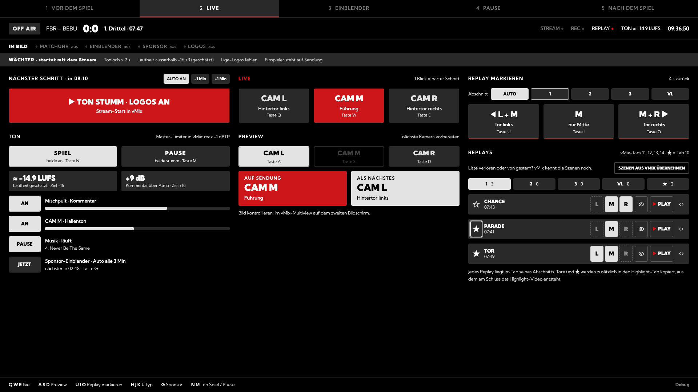
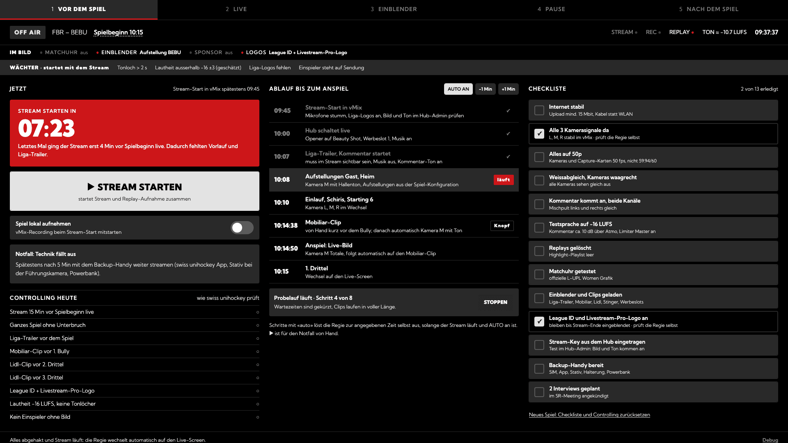
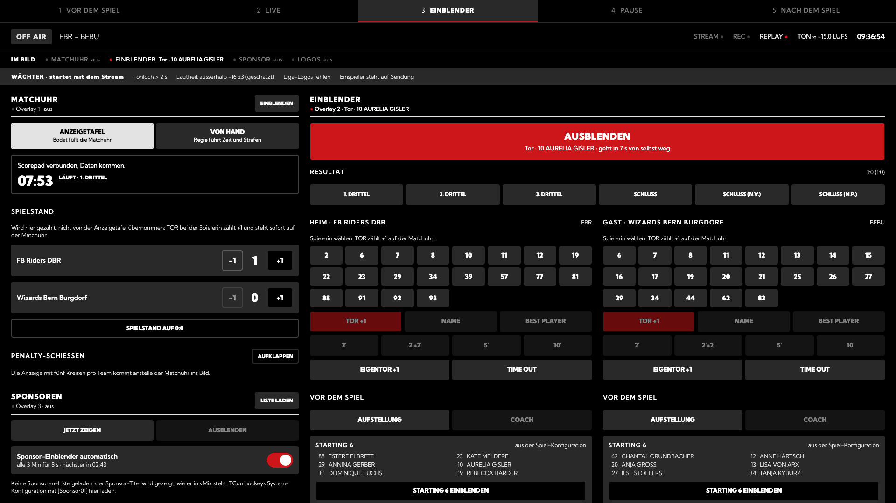
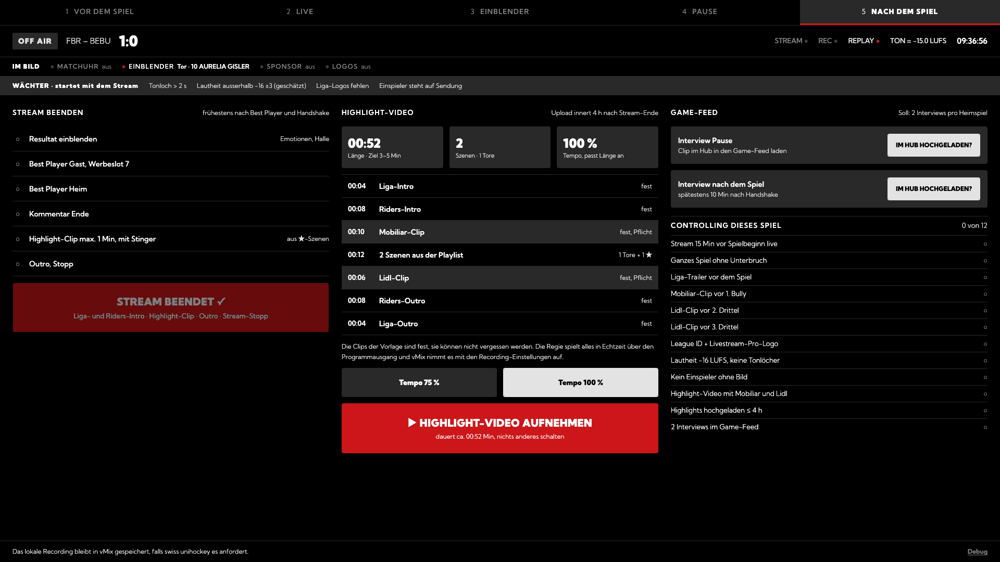
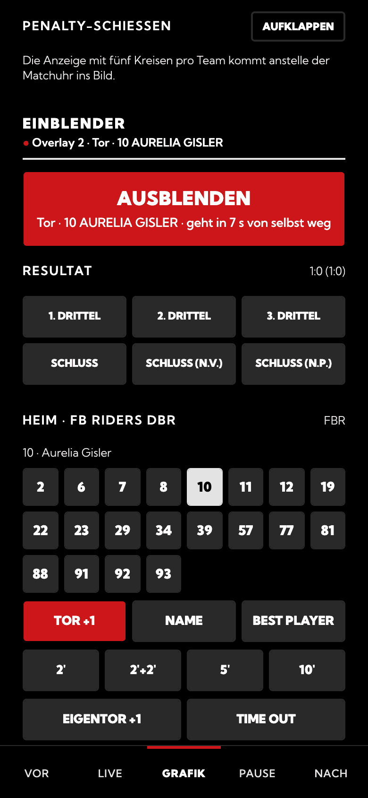

# vMix Regie Panel

The panel controls vMix for a floorball livestream. It runs on the vMix computer. Phones in the same network open it in a browser.

The panel does these tasks:

- It runs the pre-game sequence of the swiss unihockey livestream rules (clips, line-ups, logos).
- It marks replays and makes the highlight video.
- It shows the match clock from the Bodet Scorepad or by hand.
- It shows the on-screen graphics. It replaces TC Unihockey.
- It monitors the stream for the controlling (audio, loudness, logos, clips).



| Before the game | On-screen graphics |
| --- | --- |
|  |  |
| **After the game** | **On a phone** |
|  |  |

## Install

You need a Windows computer with vMix and [Node.js](https://nodejs.org) LTS.

1. In vMix, open **Settings → Web Controller**. Enable it on port `8088`.
2. Download `vmix-regie-panel.zip` from the [latest release](https://github.com/FB-Riders/vmix-control/releases/latest).
3. Unzip the file, for example to the desktop.
4. Double-click `start.bat`.
5. Read the address in the window, for example `http://192.168.1.20:8090`.
6. Open this address on a phone or on the vMix computer.

If Windows asks about the firewall, allow Node.js for private networks.

## Build from the source code

You also need [Git](https://git-scm.com). Enter these commands in a terminal:

```
git clone https://github.com/FB-Riders/vmix-control.git
cd vmix-control
corepack enable
pnpm install
pnpm build
```

Then double-click `start.bat`.

## Try it without vMix

Enter these commands in three terminals:

```
pnpm mock    # simulates vMix on port 8088
pnpm bodet   # simulates the Scorepad on port 4001
VMIX_HOST=127.0.0.1 pnpm dev
```

On Windows PowerShell, use this command for the third terminal: `$env:VMIX_HOST="127.0.0.1"; pnpm dev`.

Then open `http://localhost:5173`.

## Adapt it to your club

1. Open `config.json`.
2. Set `vmix.host` to the address of the vMix computer. Use `127.0.0.1` if the panel runs on the vMix computer.
3. Change the input names to the names in your vMix project.
4. Change the clips, sponsors and sequences for your league.
5. Start `start.bat` again.

When the panel starts, it shows the input names that vMix does not know.

For all settings and functions, refer to [docs/reference.md](docs/reference.md).

## License

MIT. Refer to [LICENSE](LICENSE). There is no warranty.
